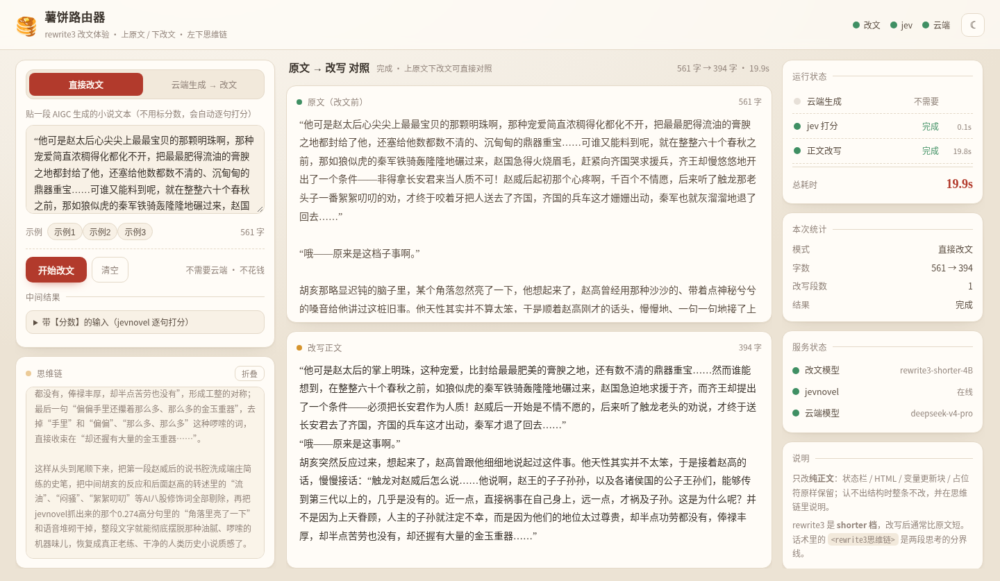
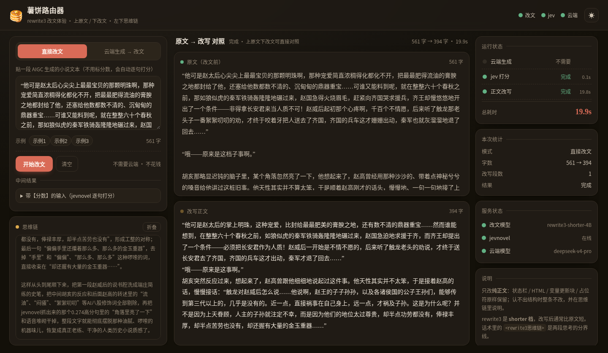

# 薯饼路由器 🥞

> **让云端大模型写出来的小说 / 角色扮演，先过一遍本地「改文模型」，把 AI 味洗掉，再把正文交给酒馆。**
>
> 酒馆里能同时看到：云端模型的**原生思维链** + 改文模型的**改文思维链**。

[](https://github.com/aikexue170/rewrite/stargazers)
[](TECHNICAL.md)
[](TECHNICAL.md)
[](https://huggingface.co/aikexue170)

---

## 这是什么

SillyTavern（或任何 OpenAI 兼容客户端）连上它，请求会被这样处理：

```
SillyTavern ──▶ 薯饼路由器 ──▶ 云端模型（DeepSeek / Kimi / GLM / OpenRouter…）
                    │              │ 原生思维链 → 实时显示
                    │              │ 正文 → 扣下，不显示
                    │
                    ├──▶ jevnovel 0.8B  逐句打分，拼成「原句【0.23】」
                    └──▶ rewrite3 4B    整篇改文 + 改文思维链

最终回到酒馆：云端原生思维链 → 〔rewrite3思维链〕 → 改文思维链 → 改写后的正文
```

一句话：**云端负责写，本地 rewrite3 负责把「不像人写的」改掉，你在酒馆里只用看最终正文。**

云端模型的正文不会直接流出来污染屏幕；改文模型也不是外挂提示词——它是在 2 万条人类网文上专门训练过的，会把 AIGC 的八股句式、解释癖、注水描写识别出来再重写。

---

## 效果

自带体验前端，不用装酒馆就能直接玩（`http://127.0.0.1:8011/`）：



深色模式：



接入酒馆后，思考区会同时显示云端模型的原始思考和改文模型的思考，正文只出现改写后的结果。

---

## 为什么用它

- **双思维链同屏**：云端原生 CoT 和改文 CoT 都塞进酒馆的思考区，能看清「为什么这么改」。
- **只改纯正文**：状态栏、HTML 面板、MVU 变量更新块、`<SUOT>` 选项、占位符这些结构内容**原样保留**，不会被改坏；认不出结构时整条跳过改文。
- **剧情选项不会被改写**：结尾的 A/B/C 选项、编号台词会原样留着（这条是专门处理过的）。
- **云端模型列表透传**：酒馆里的模型下拉直接来自云端 `/v1/models`，选 `deepseek-flash` 还是 `deepseek-v4-pro` 都行，不用在本地配模型名。
- **失败了不会聊天爆炸**：改文模型挂了自动输出云端原文；jev 挂了全标 `【NA】` 继续改；云端挂了直接报错。
- **自带测试前端**：贴一段 AIGC 文本就能体验改文模型，还有红绿灯显示「云端生成 / jev 打分 / 正文改写」进行到哪一步。
- **Windows 也能跑**：带 `.bat` 一键脚本（Windows 上改文模型建议用 llama.cpp）。

---

## 需要准备的模型（Hugging Face）

改文模型（任选一个精度，越小越省显存）：

| 版本 | 链接 | 说明 |
|---|---|---|
| Q4_K_M | [rewrite3-4b-shorter-q4km](https://huggingface.co/aikexue170/rewrite3-4b-shorter-q4km) | 2.6G，llama.cpp，最省显存 |
| Q8_0 | [rewrite3-4b-shorter-q8](https://huggingface.co/aikexue170/rewrite3-4b-shorter-q8) | 4.6G，llama.cpp，画质/体积平衡 |
| FP8 | [rewrite3-4b-shorter-fp8](https://huggingface.co/aikexue170/rewrite3-4b-shorter-fp8) | 5.5G，vLLM（NVIDIA） |
| NVFP4 | [rewrite3-4b-shorter-nvfp4](https://huggingface.co/aikexue170/rewrite3-4b-shorter-nvfp4) | 4.0G，vLLM（NVIDIA Blackwell） |
| BF16 | [rewrite3-4b-shorter-bf16](https://huggingface.co/aikexue170/rewrite3-4b-shorter-bf16) | 8.7G，原始权重（含 MTP 头） |

打分模型：

| 模型 | 链接 | 说明 |
|---|---|---|
| jevnovel 3 0.8B FP8 | [jev-novel-3-0.8b-fp8](https://huggingface.co/aikexue170/jev-novel-3-0.8b-fp8) | 逐句判「烂完了」概率，2G 显存就够 |

合集：[rewrite3 on Hugging Face](https://huggingface.co/collections/aikexue170/rewrite3-6ae8d2d4a8c5f6550fa5706f)

> **显存要求比想象中低**：改文模型是 4B，Q4_K_M 约 2.6G、Q8 约 4.6G、FP8 约 5.5G；jev 0.8B 加开销约 2G。
> **8G 卡就能爽玩，6G 卡极限也能跑**，24G 随便挑。

---

## 5 分钟上手

### 1. 装路由本体

```bash
git clone https://github.com/aikexue170/rewrite.git
cd rewrite
python3 -m venv .venv
.venv/bin/pip install -r requirements.txt
```

> Windows：双击 `setup_windows.bat`，它会建好 venv 并装依赖。

### 2. 起两个本地服务

**改文模型**（llama.cpp 或 vLLM 二选一）：

```bash
# llama.cpp（AMD/CPU/Windows 都能用）
GGUF=/path/to/rewrite3-shorter-4B-Q8_0.gguf PORT=8080 tools/start_rewrite_llama.sh

# 或 vLLM（NVIDIA，>=0.28，支持 MTP 投机解码）
MODEL_DIR=/path/to/rewrite3-shorter-4B-FP8 PORT=8080 tools/start_rewrite_vllm.sh
```

**jevnovel 打分**（需要单独的 torch 环境）：

```bash
pip install torch --index-url https://download.pytorch.org/whl/cu124   # 按显卡选源
pip install -r tools/requirements-jev.txt
JEV_MODEL_DIR=/path/to/jev-0.8B-1007-fp8 PORT=8885 tools/start_jev.sh
```

### 3. 填配置、启动

```bash
cp config.example.json config.json
# 编辑 config.json：填 cloud.api_key / cloud.base_url / cloud.model
# 确认 rewrite.base_url 和 jev.base_url 指向上面两个服务
.venv/bin/python main.py
```

启动后：

- 浏览器体验前端 → **http://127.0.0.1:8011/**
- 酒馆接入 → **http://127.0.0.1:8011/v1**

### 4. 接入酒馆

| 项目 | 填什么 |
|---|---|
| 连接类型 | **Chat Completion** |
| Source | **Custom (OpenAI-compatible)** |
| Custom Endpoint | `http://127.0.0.1:8011/v1` |
| API Key | 随便填（本服务不校验） |
| 模型 | 下拉里选云端模型（`deepseek-flash` / `deepseek-v4-pro`…） |

手机/别的电脑连：`http://<你这台电脑的局域网IP>:8011/v1`，记得放行防火墙 8011 端口。

---

## 文档

| 文件 | 内容 |
|---|---|
| [TECHNICAL.md](TECHNICAL.md) | 部署细节、配置项全表、结构保护原理、常见问题、实测数据 |
| [SKILL.md](SKILL.md) | 给 AI coding agent 看的部署说明书（环境检查 → 下模型 → 配置 → 起服务 → 验证） |
| [AGENTS.md](AGENTS.md) | AGENTS 规范入口，指向 SKILL.md |

---

## 常见问题

**要多少显存？**
改文模型是 4B，量化后非常小：Q4_K_M 约 2.6G、Q8 约 4.6G、FP8 约 5.5G；jev 0.8B 带开销约 2G。

- **8G 卡：能爽玩** —— Q4_K_M（或 Q8 配小一点的上下文）+ jev 同卡
- **6G 卡：极限能跑** —— Q4_K_M + 小上下文（`-c 4096`），jev 同卡，把参数压到最省就是（能玩，但别指望开大上下文）
- **12G～16G：很舒服** —— Q8 / FP8 + jev 同卡
- **24G 及以上：随便挑** —— 更大上下文、更高吞吐，甚至能上 BF16

**为什么正文等很久才出来？**
这是「整篇模式」：云端写完后，改文模型要先写 3～4 千 token 的分析，再输出正文。等待期间思维链一直在动。想更快可以调 `pipeline.max_source_chars` 或关掉 `body_after_cot`。

**改文会不会把状态栏/选项改坏？**
不会。结构化内容会被识别为「保留段」逐字节保留，只有纯正文送改文；认不出结构时整条跳过并提示。

**改文太狠、描写被砍了？**
rewrite3 是 shorter 档（任务定义就是压短，0.4～1.0 倍），遇到 AI 味重的描写会砍得比较狠。想要保留长度等 keep 版模型。

更多见 [TECHNICAL.md](TECHNICAL.md#常见问题)。

---

## 致谢

- 转发骨架 / SSE 思路参考了 [薯饼迭代器](https://github.com/aikexue170)（SillyTavern 分段创作转发）
- 分句规则来自 revnovel_next 的 `jevd/sentences.py`
- 改文模型与 jevnovel 由本项目配套训练、发布在 [Hugging Face](https://huggingface.co/aikexue170)
- 基座：Qwen3.5（权重遵循 Qwen 许可）

代码可自用、可二改，转载/分发请保留出处；模型权重请遵循各自基座的许可证。
