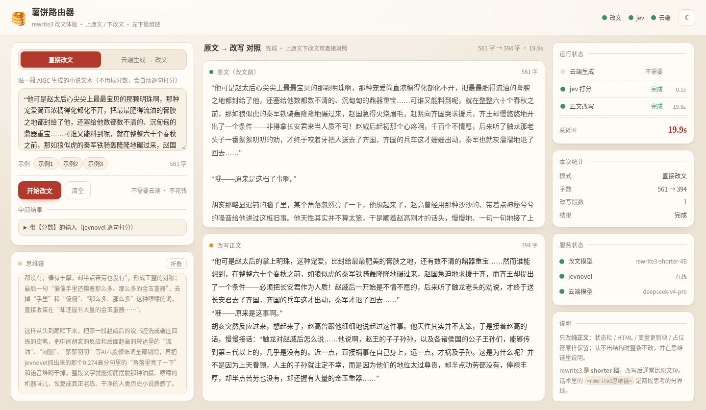
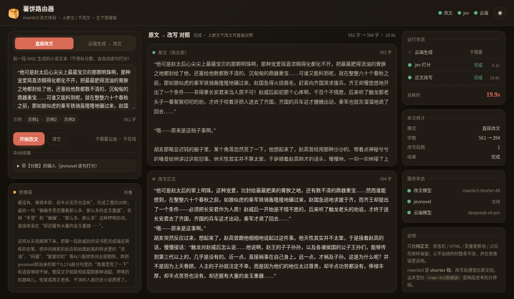

# 薯饼路由器 🥞

> **让云端大模型写出来的小说 / 角色扮演，先过一遍本地「改文模型」，把 AI 味洗掉，再把正文交给酒馆。**
>
> 酒馆里能同时看到：云端模型的**原生思维链** + 改文模型的**改文思维链**。

[](https://github.com/aikexue170/rewrite/stargazers)
[](TECHNICAL.md)
[](TECHNICAL.md)
[](https://huggingface.co/aikexue170)

---

> ## ⚠️ 自部署必读：第三方预设要先适配 spec
>
> 本仓库只带作者自用的 `beileng-3-0.json` 和教学模板 `example-spec.json`；**夏瑾、梦鲸思客、泉此方这类第三方预设的 spec 不随仓库分发**。
> 没有对应 spec 时，路由器会回退「通用保护」，遇到模型把思考模板写进正文、或者规划/状态栏/变量块结构复杂时，
> 会出现 **`正文被切得太碎（N 段）` 然后跳过改文**、规划或状态栏被当正文改等问题。
>
> 适配流程（给 AI agent 的完整 skill）：**[SKILL-preset.md](SKILL-preset.md)**。一句话：
> `python tools/parse_preset.py 你的预设.json --out preset_specs/你的预设.json`，再按真实回复补齐
> `plain_body.after` / `keep_tags` 等结构规则，最后用一条真实请求验证「只改正文」。第三方 spec 只放本地，不要提交。

## 这是什么

SillyTavern（或任何 OpenAI 兼容客户端）连上它，请求会被这样处理：

```
SillyTavern ──▶ 薯饼路由器 ──▶ 云端模型（DeepSeek / Kimi / GLM / OpenRouter…）
                    │              │ 原生思维链 → 实时显示
                    │              │ 正文 → 扣下，不显示
                    │
                    ├──▶ ST 预设解析    认出当前预设，只抽「可改写正文」
                    ├──▶ jevnovel 0.8B  逐句打分，拼成「原句【0.23】」
                    └──▶ rewrite3 27B   整篇改文 + 改文思维链

最终回到酒馆：云端原生思维链 → 〔rewrite3思维链〕 → 改文思维链 → 改写后的正文
```

一句话：**云端负责写，本地 rewrite3 负责把「不像人写的」改掉，你在酒馆里只用看最终正文。**

云端模型的正文不会直接流出来污染屏幕；改文模型也不是外挂提示词——它是在 2 万条人类网文上专门训练过的，会把 AIGC 的八股句式、解释癖、注水描写识别出来再重写。

---

## 效果

自带体验前端，不用装酒馆就能直接玩（`http://127.0.0.1:8011/`）：



深色模式：



接入酒馆后，思考区会同时显示云端模型的原始思考和改文模型的思考，正文只出现改写后的结果。

---

## 为什么用它

- **双思维链同屏**：云端原生 CoT 和改文 CoT 都塞进酒馆的思考区，能看清「为什么这么改」。
- **预设自动适配**：不同 ST 预设的回复结构各不相同（有的用 XML 标签把规划/正文/状态栏分开，有的正文不带标签、只能靠锚点定位）。命中预设后按预设规则只抽正文送改文，规划、场景栏、状态栏原样保留；认不出预设时回退通用结构保护。仓库内置作者自用预设的 spec + 一份教学模板，第三方预设用自己的本地预设生成。
- **只改纯正文**：状态栏、HTML 面板、MVU 变量更新块、`<SUOT>` 选项、占位符这些结构内容**原样保留**，不会被改坏；认不出结构时整条跳过改文。
- **剧情选项不会被改写**：结尾的 A/B/C 选项、编号台词会原样留着（这条是专门处理过的）。
- **云端模型列表透传**：酒馆里的模型下拉直接来自云端 `/v1/models`，选 `deepseek-flash` 还是 `deepseek-v4-pro` 都行，不用在本地配模型名。
- **失败了不会聊天爆炸**：改文模型挂了自动输出云端原文；jev 挂了全标 `【NA】` 继续改；云端挂了直接报错。
- **自带测试前端**：贴一段 AIGC 文本就能体验改文模型，还有红绿灯显示「云端生成 / jev 打分 / 正文改写」进行到哪一步。
- **Windows 也能跑**：带 `.bat` 一键脚本（Windows 上改文模型建议用 llama.cpp）。

---

## 预设解析（preset_specs/）

不同 SillyTavern 预设的模型回复结构不一样：有的用 XML 标签把规划、正文、状态栏分开，
有的正文干脆不带标签、只能靠固定开场句/结束锚点定位。通用结构保护只能按标签名猜，
容易把「规划」「场景栏」当正文改掉。

本仓库的 `preset_specs/` 把「这个预设的正文在哪」变成数据。目录里只带两份：
`beileng-3-0.json`（北棱自用预设，零标签）和 `example-spec.json`（教学模板）。
**第三方预设的 spec 不随仓库分发**——spec 里的指纹是预设提示词原文片段，公开等于
转载别人的预设；请用你自己本地的预设生成一份（只自己用）：

- **匹配**：入站 messages 里的预设提示词长句指纹（ST 托管路径最准），或正文里的结构标记；
- **抽取**：按 spec 的 `keep_tags` / `body_tags` / `plain_body` 锚点切分，结构块原样保留，
  正文区内部再交给通用保护层二次切分；
- **回退**：没命中预设就走原来的通用保护逻辑，行为与旧版一致——但这时如果云端回复结构复杂
  （思考模板写进正文、多段状态栏等），就可能出现 **`正文被切得太碎（N 段）` 跳过改文**。
  这不是 bug，是提示你该给这个预设适配 spec 了（见 [SKILL-preset.md](SKILL-preset.md)）。

> **2026-11-15 修复**：云端模型偶尔把「思考模板」写进正文（而不是 `reasoning_content`）。
> 新版本会先做 `strip_thinking`：成对 `<think>` / `<｜begin▁of▁thinking｜>` 块直接剥离；
> 只有开头没有结尾时，用 spec 的 `plain_body.after` 最靠后一次出现的开场锚点当回答起点。
> 剥出来的思考走思维链，不再被当正文打 JEV 分/送改文。旧版独立仓库如果没有这个修复，请先升级。

加新预设 = 往 `preset_specs/` 放一份 spec，不用改代码、不用重启（目录变了自动重载）：

```bash
# 用你自己的 ST 预设生成草稿（生成的文件在 .gitignore 里，不会被误提交）
python tools/parse_preset.py 你的预设定/某预设.json --out preset_specs/某预设.json
# 人工补结构规则后校验
python tools/parse_preset.py --check preset_specs/
```

spec 的字段说明和「自动生成推不准、需要人工补的地方」见
[`preset_specs/README.md`](preset_specs/README.md)。

---

## 需要准备的模型（Hugging Face）

改文模型是 **rewrite3-27B**（中文小说改写特化，自带 MTP 投机解码），任选一个格式：

| 版本 | 链接 | 说明 |
|---|---|---|
| IQ3_XS | [rewrite3-27b-iq3xs](https://huggingface.co/aikexue170/rewrite3-27b-iq3xs) | 12.3G，llama.cpp，极限小显存 |
| Q3_K_M | [rewrite3-27b-q3km](https://huggingface.co/aikexue170/rewrite3-27b-q3km) | 13.7G，llama.cpp，16G 有余量 |
| IQ4_XS | [rewrite3-27b-iq4xs](https://huggingface.co/aikexue170/rewrite3-27b-iq4xs) | 15.5G，llama.cpp，16G 首选（质量/体积平衡） |
| Q4_K_M | [rewrite3-27b-q4km](https://huggingface.co/aikexue170/rewrite3-27b-q4km) | 17.0G，llama.cpp，16G 塞不下（建议 IQ4_XS） |
| FP8 | [rewrite3-27b-fp8](https://huggingface.co/aikexue170/rewrite3-27b-fp8) | 35.9G，vLLM，主力部署（48G 级） |
| BF16 | [rewrite3-27b-bf16](https://huggingface.co/aikexue170/rewrite3-27b-bf16) | 54.7G，原始权重，质量基准 |

> HF 上还有 NVFP4 版本，但这个量化效果不佳，不建议使用；显存紧张优先 IQ4_XS。

打分模型：

| 模型 | 链接 | 说明 |
|---|---|---|
| jevnovel 3 0.8B FP8 | [jev-novel-3-0.8b-fp8](https://huggingface.co/aikexue170/jev-novel-3-0.8b-fp8) | 逐句判「烂完了」概率，2G 显存就够 |

合集：[rewrite3-27B on Hugging Face](https://huggingface.co/collections/aikexue170/rewrite3-27b-6af8f9ac120d5e7caed9a94c)

> **显存要求**：27B 的 llama.cpp GGUF 里，IQ3_XS 约 12.3G、IQ4_XS 约 15.5G，
> **16G 卡建议 IQ4_XS**（上下文 `-c 16384` 左右；再高就上 24G+）；Q4_K_M 17G 在 16G 卡上塞不下。
> vLLM FP8 需要 48G 级显存。jev 0.8B 另需约 2G，可以和改写同卡或放 CPU。

---

## 5 分钟上手

### 1. 装路由本体

```bash
git clone https://github.com/aikexue170/rewrite.git
cd rewrite
python3 -m venv .venv
.venv/bin/pip install -r requirements.txt
```

> Windows：双击 `setup_windows.bat`，它会建好 venv 并装依赖。

### 2. 起两个本地服务

**改文模型**（llama.cpp 或 vLLM 二选一）：

```bash
# llama.cpp（AMD/CPU/Windows 都能用；GGUF 里已内嵌 MTP）
GGUF=/path/to/rewrite3-27b-IQ4_XS.gguf PORT=8080 tools/start_rewrite_llama.sh

# 或 vLLM（NVIDIA，>=0.28，支持 MTP 投机解码；FP8 需 48G 级显存）
MODEL_DIR=/path/to/rewrite3-27b-fp8 PORT=8080 tools/start_rewrite_vllm.sh
```

**jevnovel 打分**（需要单独的 torch 环境）：

```bash
pip install torch --index-url https://download.pytorch.org/whl/cu124   # 按显卡选源
pip install -r tools/requirements-jev.txt
JEV_MODEL_DIR=/path/to/jev-0.8B-1007-fp8 PORT=8885 tools/start_jev.sh
```

### 3. 填配置、启动

```bash
cp config.example.json config.json
# 编辑 config.json：填 cloud.api_key / cloud.base_url / cloud.model
# 确认 rewrite.base_url 和 jev.base_url 指向上面两个服务
.venv/bin/python main.py
```

启动后：

- 浏览器体验前端 → **http://127.0.0.1:8011/**
- 酒馆接入 → **http://127.0.0.1:8011/v1**

### 4. 接入酒馆

| 项目 | 填什么 |
|---|---|
| 连接类型 | **Chat Completion** |
| Source | **Custom (OpenAI-compatible)** |
| Custom Endpoint | `http://127.0.0.1:8011/v1` |
| API Key | 随便填（本服务不校验） |
| 模型 | 下拉里选云端模型（`deepseek-flash` / `deepseek-v4-pro`…） |

手机/别的电脑连：`http://<你这台电脑的局域网IP>:8011/v1`，记得放行防火墙 8011 端口。

---

## 文档

| 文件 | 内容 |
|---|---|
| [TECHNICAL.md](TECHNICAL.md) | 部署细节、配置项全表、结构保护原理、常见问题、实测数据 |
| [SKILL.md](SKILL.md) | 给 AI coding agent 看的部署说明书（环境检查 → 下模型 → 配置 → 起服务 → 验证） |
| [AGENTS.md](AGENTS.md) | AGENTS 规范入口，指向 SKILL.md |

---

## 常见问题

**要多少显存？**
改文模型是 27B；jev 0.8B 另需约 2G（可同卡或 CPU）。

- **12G 卡：极限能跑** —— IQ3_XS（12.3G）+ 小上下文（`-c 8192`），jev 放 CPU
- **16G 卡：能舒服玩** —— IQ4_XS（15.5G，`-c 16384`）+ jev 同卡；预算紧就 IQ3_XS
- **24G 卡：很宽裕** —— IQ4_XS 开大上下文 / Q4_K_M；jev 同卡
- **48G 级：vLLM** —— FP8（35.9G）主力部署，吞吐最好；BF16 需要 80G 级

**为什么正文等很久才出来？**
这是「整篇模式」：云端写完后，改文模型要先写 3～4 千 token 的分析，再输出正文。等待期间思维链一直在动。想更快可以调 `pipeline.max_source_chars` 或关掉 `body_after_cot`。

**改文会不会把状态栏/选项改坏？**
不会。结构化内容会被识别为「保留段」逐字节保留，只有纯正文送改文；认不出结构时整条跳过并提示。

**为什么提示「正文被切得太碎（N 段）」？**
九成是这个预设还没适配 spec，被通用保护层猜错了结构。按 [SKILL-preset.md](SKILL-preset.md) 给这个预设生成
spec（用自己本地的预设文件），补齐结构锚点后再试；第三方 spec 只放本地，不要提交到仓库。

**自测**：`python tests/test_thinking_strip.py`（思考模板剥离回归）、`python tests/test_presets.py`（预设解析）。

**改文字数变化大吗？**
rewrite3-27B 是「保持长度」档（0.9～1.1 倍），不会大砍篇幅；如果发现明显变短，先确认 `INSTRUCTION.txt` 没被换掉、`rewrite.model` 和启动时的 alias/代理名一致。

更多见 [TECHNICAL.md](TECHNICAL.md#常见问题)。

---

## 致谢

- 转发骨架 / SSE 思路参考了 [薯饼迭代器](https://github.com/aikexue170)（SillyTavern 分段创作转发）
- 分句规则来自 revnovel_next 的 `jevd/sentences.py`
- 改文模型与 jevnovel 由本项目配套训练、发布在 [Hugging Face](https://huggingface.co/aikexue170)
- 基座：Qwen3.5（权重遵循 Qwen 许可）

代码可自用、可二改，转载/分发请保留出处；模型权重请遵循各自基座的许可证。
