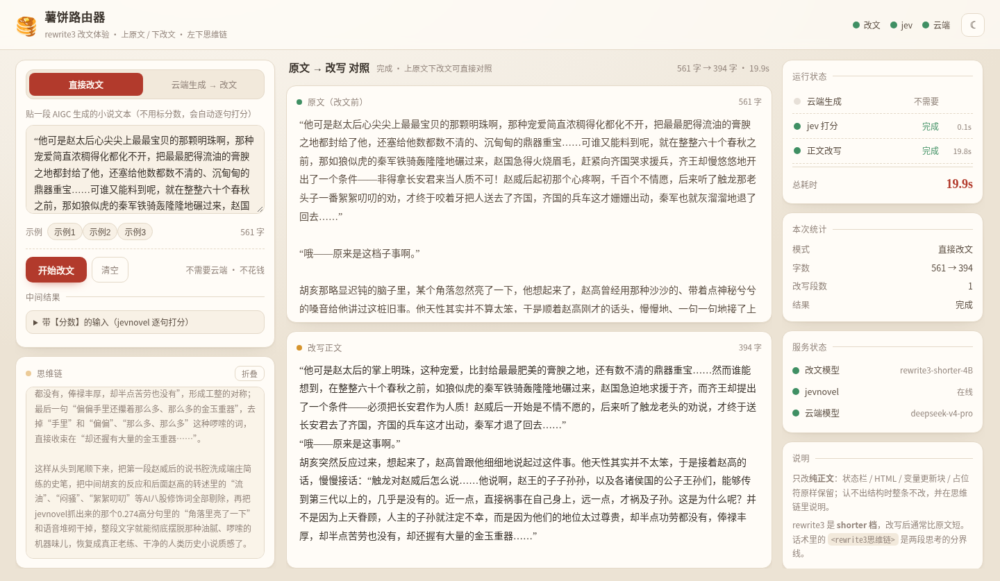
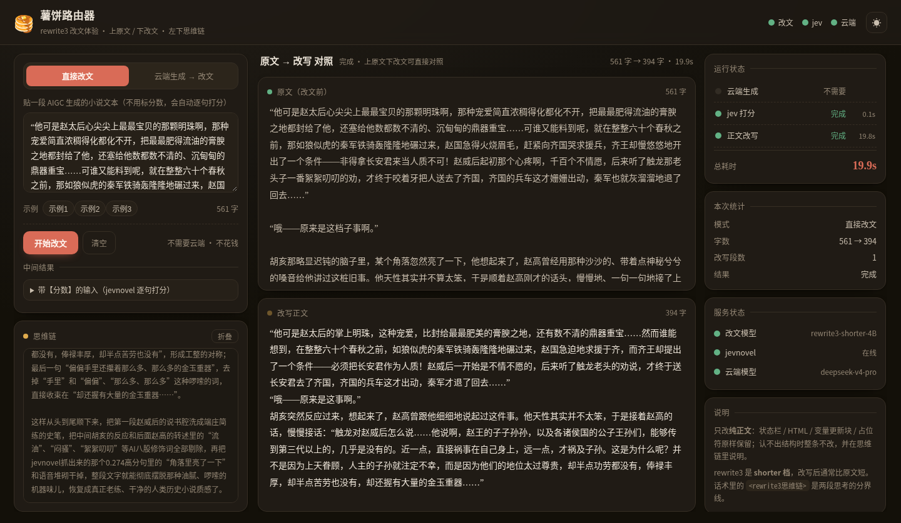

# 薯饼路由器 · 技术文档

> 这篇是**部署、配置、原理、排查**等技术细节。
> 想先了解这是什么、怎么用，看 [README.md](README.md)；想让 AI agent 帮你部署，看 [SKILL.md](SKILL.md)。


给 SillyTavern 用的转发服务：接上你自己的云端模型，再挂上 rewrite3 和 jevnovel，让云端写出来的东西先过一遍改文，然后才回到酒馆里。

```
SillyTavern ──▶ 薯饼路由器 ──▶ 云端模型（生成 + 原生思维链）
                    │
                    ├──▶ jevnovel 0.8B（逐句打分）
                    └──▶ rewrite3 4B（整篇改文 + 改文思维链）
```

用户看到的顺序：

1. 云端模型的思维链（灰色小字，实时）
2. 一行 `〔rewrite3思维链〕`
3. 改文模型的思维链（灰色小字，实时）
4. 改文后的正文（实时）

云端模型的正文全程不显示，只在后台收完整、打完分、交给改文模型。

项目自带一个**测试前端**（不用酒馆）：启动后浏览器打开 `http://127.0.0.1:8011/` 就能直接体验改文模型。

---

## 自带测试前端（不用酒馆）

启动路由后，浏览器打开 **http://127.0.0.1:8011/** ：



- **浅色为主，可切深色**：默认米白/红色调，右上角切换深浅色（也支持 URL 加 `#dark` / `#light` 直接进对应主题）。
- **中栏上下对照**：上面是原文（直接改文模式=你贴的文本；云端模式=云端原始输出），下面是改写正文，同一屏上下对着看。
- **左下角思维链**：改文模型的思维链放在左下角独立滚动区；云端模式下云端原生思维链会先出现在这里，再出现 `〔rewrite3思维链〕` 分界线和改文思维链。
- **直接改文**：贴一段 AIGC 生成的小说文本 → 自动用 jevnovel 逐句打分 → 改文模型分析 + 改写，不需要云端模型、不花钱。
- **云端生成 → 改文**：写一句场景，云端模型先写，写完自动接改文流程；左上角有**模型下拉**，列表直接来自云端 `/v1/models`（deepseek-flash / deepseek-v4-pro 都能选）。
- **运行状态红绿灯**：右侧三个灯分别对应 云端生成 / jev 打分 / 正文改写，黄灯=进行中、绿灯=完成、红灯=出错、灰灯=跳过或不需要，带每段耗时。
- **思维链全部出完，正文才出来**：多段结构（正文被状态栏切成好几段）时也一样——不会出现"思维链还没出完，正文先蹦出来"；正文带轻微打字机节奏。想要边改边看可以把 `pipeline.body_after_cot` 设成 `false`。
- **滚动不会被抢**：任何面板（思维链/原文/改文）只要往上滚，就锁住当前位置不再自动跟随；底部出现「↓ 回到最新」，点一下才恢复跟随。
- **中间结果可展开**：带【分数】的输入、云端输入（发给云端的 messages）随时展开查看。
- 页面自带 3 条真实 AIGC 示例，一键载入；检测到前端结构（状态栏/HTML/变量块）时会提示「整条未改」并给出原因。

深色模式：



---

## 需要准备三个东西

| 东西 | 是什么 | 怎么来 |
|---|---|---|
| 云端模型 | 任意 OpenAI 兼容 API（DeepSeek / Kimi / GLM / OpenRouter / 硅基流动…） | 填 `config.json` 里的 `cloud` |
| 改文模型 | rewrite3-shorter-4B（bf16/fp8/gguf 都行） | HF 下载，vLLM 或 llama.cpp 起服务 |
| jevnovel | jevnovel-3 0.8B（打分用） | HF 下载，用 `tools/serve_jev.py` 起服务 |

显存参考：改文模型 fp8 约 6G / Q8 GGUF 约 5G，jev 0.8B 约 2G，24G 卡两张一起跑没问题。

## 快速开始

### 1. 装依赖

需要 **Python 3.10+**。

```bash
cd 薯饼路由器
python3 -m venv .venv
.venv/bin/pip install -r requirements.txt
```

Windows 用户不用敲这些，直接双击 `setup_windows.bat`，见下面「Windows 用户」。

### 2. 起改文模型（二选一）

```bash
# NVIDIA 卡，vLLM（>=0.28，支持 MTP 投机解码）
MODEL_DIR=/path/to/rewrite3-shorter-4B-FP8 PORT=8080 tools/start_rewrite_vllm.sh

# 或者 llama.cpp（AMD/CPU 也能跑，Q8 GGUF）
GGUF=/path/to/rewrite3-shorter-4B-Q8_0.gguf PORT=8080 tools/start_rewrite_llama.sh
```

### 3. 起 jevnovel 打分服务

模型包去 HF 下：[aikexue170/jev-novel-3-0.8b-fp8](https://huggingface.co/aikexue170/jev-novel-3-0.8b-fp8)（目录里要有 `infer.py`）。

它和路由不是同一套 Python 依赖（需要 torch + transformers，而且 torch 要按显卡选安装源），所以单独一份：

```bash
# 1) 先装 torch（按自己的卡选一个源）
pip install torch --index-url https://download.pytorch.org/whl/cu124   # NVIDIA
# pip install torch --index-url https://download.pytorch.org/whl/rocm6.2  # AMD Linux
# 2) 再装 jevnovel 服务依赖
pip install -r tools/requirements-jev.txt

# 3) 起服务
JEV_MODEL_DIR=/path/to/jev-0.8B-1007-fp8 PYTHON=python PORT=8885 tools/start_jev.sh
```

### 4. 填配置

```bash
cp config.example.json config.json
```

只有一个文件，通常只需要改这几处：

```json
"cloud":  { "base_url": "https://api.deepseek.com/v1", "api_key": "sk-xxx", "model": "deepseek-v4-pro" },
"rewrite":{ "base_url": "http://127.0.0.1:8080/v1" },
"jev":    { "base_url": "http://127.0.0.1:8885" }
```

### 5. 启动

```bash
.venv/bin/python main.py
```

启动横幅会打印三个下游服务通没通、酒馆该填的地址，以及测试前端地址：

- 测试前端（先体验模型）：`http://127.0.0.1:8011/`
- 酒馆连接：`http://127.0.0.1:8011/v1`

### 6. 接入酒馆

- 连接类型：**Chat Completion**
- Source：**Custom (OpenAI-compatible)**
- Custom Endpoint：`http://127.0.0.1:8011/v1`（其他设备用横幅里的局域网地址）
- API Key：随便填（本服务不校验）
- 模型：能看到云端模型的名字就选它

---

## Windows 用户

代码本身是跨平台的（全用 pathlib，没有 Linux 专属调用），项目里带了一套 `.bat` 启动器。

### 一次安装

1. 装 **Python 3.10+**（python.org 安装器，勾选 "Add Python to PATH"）
2. 双击 **`setup_windows.bat`** —— 自动建 `.venv`、装依赖、生成 `config.json`
3. 编辑 `config.json`，填 `cloud.api_key` / `cloud.base_url` / `cloud.model`

### 跑起来

| 服务 | 双击 |
|---|---|
| 改文模型（llama.cpp） | `tools\start_rewrite_llama.bat` |
| jevnovel 打分 | `tools\start_jev.bat` |
| 路由 + 测试前端 | `start_router.bat` |

- **改文模型**：去 llama.cpp Releases 下 Windows 的 **CUDA / Vulkan** 版，把 `llama-server.exe` 加到 PATH；模型默认找 `%USERPROFILE%\models\rewrite3-shorter-4B-Q8_0.gguf`，也可以先 `set GGUF=D:\models\xxx.gguf` 再双击。
- **jevnovel**：先装它的依赖（和路由分开，需要 torch + transformers）：

  ```bat
  .venv\Scripts\pip install torch --index-url https://download.pytorch.org/whl/cu124
  .venv\Scripts\pip install -r tools\requirements-jev.txt
  set JEV_MODEL_DIR=D:\models\jev-0.8B-1007-bf16
  ```

  然后双击 `tools\start_jev.bat`（想用别的 Python 解释器先 `set PYTHON=...`）。
- **vLLM 官方不支持原生 Windows**（只能 WSL2），所以 Windows 上推荐 llama.cpp；`tools\start_rewrite_vllm.bat` 只是个提示。
- 三个都起来后浏览器打开 `http://127.0.0.1:8011/`。

### Windows 注意

- **路径**：项目放在中文/带空格目录也能跑（Python 3 没问题），但模型路径建议纯英文；`config.json` 里的 Windows 路径写 `D:/models/xxx` 或 `D:\models\xxx` 都行。
- **控制台编码**：`.bat` 已经 `chcp 65001` + `PYTHONUTF8=1`，Python 里也有 UTF-8 兜底（`✓`/`⚠` 这类符号在重定向日志时不会炸）；还是乱码就手动敲一次 `chcp 65001`。
- **防火墙**：手机/别机连 `http://<电脑IP>:8011/v1` 时，需要在 Windows Defender 防火墙放行 8011 端口（入站规则 → 端口 8011）。
- `tools/*.sh` 是 Linux/macOS 用的，Windows 用同名 `.bat`。

## 模型是透传的

- 酒馆（和测试前端）的模型下拉列表 = 云端 `/v1/models` 的返回，原样转发，不在这里维护模型名单；`deepseek-flash`、`deepseek-v4-pro` 都在。
- 请求里带的 `model` 会原样透传给云端；`config.json` 里的 `cloud.model` 只在请求没带 model 时兜底。
- 云端列表拉不到（断网/报错）时自动回退到 `cloud.model`，列表有 60 秒缓存。

## 配置文件说明

| 字段 | 默认 | 说明 |
|---|---|---|
| `host` / `port` | `0.0.0.0` / `8011` | 路由自己监听的地址 |
| `cloud.base_url` | `https://api.deepseek.com/v1` | 云端模型地址，要带 `/v1` |
| `cloud.api_key` | — | 云端 key |
| `cloud.model` | `deepseek-v4-pro` | 兜底模型名：请求里没指定 model 时才用它（正常情况走云端列表） |
| `cloud.forward_params` | `null` | `null` = 除 messages/model/stream 外全部原样透传；填数组则只透传列出的字段（云端对多余参数报 400 时用） |
| `cloud.min_max_tokens` | `2048` | 酒馆的 `max_tokens` 小于它时抬到它，防止云端思维链把正文预算吃光 |
| `rewrite.base_url` | `http://127.0.0.1:8080/v1` | 改文模型地址 |
| `rewrite.model` | `rewrite3-shorter-4B` | 改文模型名（vLLM `--served-model-name` / llama.cpp `--alias`） |
| `rewrite.instruction_file` | `INSTRUCTION.txt` | 改文任务指令，随仓库附带 |
| `rewrite.temperature` / `top_p` / `repetition_penalty` / `max_tokens` | `0.9/0.95/1.05/6144` | 改文采样参数，别乱调，`max_tokens` 小了会只有思维链没有正文 |
| `jev.base_url` | `http://127.0.0.1:8885` | jevnovel 服务地址 |
| `jev.chunk_chars` | `300` | 单句超过多少字就切块打分取最烂 |
| `pipeline.max_source_chars` | `3000` | 云端正文超过多少字就分段改（分段结果按顺序拼回去） |
| `pipeline.fallback_to_original` | `true` | 改文失败时直接输出云端原文 |
| `pipeline.body_after_cot` | `true` | 所有思维链出完再吐正文（多段结构时不会出现"正文先蹦出来"）；设 `false` 恢复每段改完就吐 |
| `pipeline.rewrite_cot_header` | `〔rewrite3思维链〕` | 两段思维链之间的分隔标记 |
| `protection.enabled` | `true` | 前端卡结构保护：只改纯正文，状态栏/HTML/变量块原样保留 |
| `protection.min_prose_ratio` | `0.15` | 纯正文占比低于它就整条不改 |
| `protection.max_segments` | `4` | 正文被结构块切成超过这么多段就整条不改 |
| `protection.min_rewrite_chars` | `60` | 短于这个长度的小段原样保留（不值得改） |
| `protection.note_in_reasoning` | `true` | 跳过改文时在思维链里留一句说明 |
| `sse.heartbeat_interval_s` | `5` | 多久没数据就发一次心跳（防止酒馆以为连接死了） |

---

## HTTP 接口

| 路径 | 用途 |
|---|---|
| `POST /v1/chat/completions` | 酒馆用（OpenAI 兼容，流式/非流式） |
| `GET /v1/models` | 透传云端模型的完整列表（酒馆 / 测试前端的模型下拉就是它） |
| `GET /` | 自带测试前端页面 |
| `POST /api/rewrite` | 测试前端：直接改一段文本（SSE） |
| `POST /api/generate` | 测试前端：云端生成 → 改文（SSE） |
| `GET /api/samples` | 测试前端：内置示例文本 |
| `GET /api/info` | 测试前端：服务状态（改文/jev/云端是否在线） |
| `GET /health` | 健康检查 |

## 实测数据

本机环境：RX 9070 XT（llama.cpp Q8 GGUF + MTP 投机解码）+ 局域网 4090（jev 0.8B）+ DeepSeek v4 pro。

| 阶段 | 耗时 |
|---|---|
| 云端思维链首字 | 0.7s |
| 云端写完全部正文（549 字） | 16.8s |
| 改文思维链（3400 字） | 17.7s |
| 正文首字 | 34.5s |
| 全部结束 | 40.4s |

改文模型吞吐约 **126 tok/s**（Q8 + MTP）；jev 打分 10 句约 0.5s，基本不占时间。

## 几个设计选择

**请求侧是纯透传的。**
酒馆发来的消息原样转给云端：system 里的预设/角色卡/世界书、历史消息、最新用户输入，一个字不改，也不注入我们自己的提示词。路由只接管三样东西：

- `model`：换成 config 里的 `cloud.model`（酒馆里选什么名字都行）
- `stream`：内部固定用流式
- `max_tokens`：酒馆给得太小（< `cloud.min_max_tokens`）就抬上去，防止云端思维链把正文预算吃光，设 `0` 可关闭

其余参数（temperature/top_p/stop/各种惩罚……）原样带给云端。如果哪个云端对多余字段报 400，把 `cloud.forward_params` 填成白名单数组即可。

**回传侧才拦截。**
云端的 `reasoning_content` 实时显示，正文全部扣下不显示；等云端写完，才打分、拼标记、送改文模型，最后按「改文思维链 → 改写正文」吐给酒馆。

**为什么整篇模式、正文不边写边改？**
边写边改（分段流水线）当然更快，但正文要等段落写完才能打分、改写，而且改文思维链会被切碎。整篇模式下，云端思维链一结束就能接改文思维链，两段思考都在正文前面，酒馆的思考框显示最干净，改文质量也最稳。代价是正文首字要等 30～60 秒——但这段时间里屏幕上一直有思维链在动，不会干等。

**为什么分句必须用 `app/sentences.py`？**
这个文件是从 jev 站点原样拷来的（`SENT_RULES=3`：丢掉章节标记、把 ≤12 字的短句往后并）。训练数据里的【】标记就是这么切的，换一套切法模型看到的输入分布就变了，效果会掉。

**0.8B 打分够吗？**
够。它是 jevnovel 3 27B 的蒸馏学生，训练数据里的分数就是 27B 教师打的，同一套口径。27B 光权重就 30G，为了省显存用 0.8B 划算。

## 前端卡兼容：怎么判断哪段是正文

角色卡的回复经常混着 HTML 面板、状态栏、MVU 变量更新块、占位符。改文模型会把这些当普通文本改写，标签名、JSON、占位符全被改坏。所以送改文之前，`app/protection.py` 会把回复切成「可以改的纯正文」和「必须原样保留的结构块」。

拿 `~/项目/autotavern` 里 32,075 条真实模型回复跑了一遍：

| 结果 | 占比 |
|---|---|
| 纯文本卡 → 全文改写 | 57.2% |
| 带结构 → 只改正文，结构块逐字节保留 | 38.7% |
| 整块前端面板 → 整条跳过改文 | 4.2% |

判断规则（保守优先，认不准就整条不改）：

1. **包装标签**：`<maintext>…</maintext>`、`<content>…</content>` 这类只包一层正文的标签——标签保留，里面的正文照改。
2. **结构标签**：`div`/`style`/`script`/`table`/`details`/`<StatusBlock>`/`<UpdateVariable>`/`<SceneInfo>`/`<analysis>` 等整块保护，一个字节不动。
3. **占位符/空标签**：`<StatusPlaceHolderImpl/>`、`` 标记只保留标签本身，周围正文照改。
4. **行内标签和宏**：某个段落里出现 `<br>`/`<font>`/`<span>` 或 `{{user}}`/`<user>`，这一段整段不改，其余段照改（怕把宏和格式改丢）。
5. **纯文本状态栏**：尾部连续 ≥3 行 `key：value`、`- ` 列表、`【…】`小标题，识别成状态块保留。
6. **不认识的标签**：作者把正文包在什么词里都可能（`<推文>`/`<小说>`/`<正文输出>`…）。先看名字关键词：`story/content/text/正文/reply/output` 这类当包装标签（壳保留、里面改）；`status/stats/panel/update/option/变量/选项` 这类当结构块。名字也判不出来的，**看内容特征**：长度、中文占比、句号数量、对白引号数量、JSON/代码符号占比、`key：value` 行占比——像小说正文就当包装标签，否则保护。
7. **未闭合标签不吞正文**：只有疑似 JSON/变量块才保护到结尾，其他只把标签本身当标记保留，后面的正文照改。
8. **兜底**：正文占比低于 15%、或被结构块切成超过 4 段 → 整条不改，并在思维链里写一句「检测到前端结构，跳过改文」。

实测（真实卡 + 真模型）：一条 683 字的回复，`<StatusBlock>` 里 22 行状态（含 ```json 代码块）在改写后**逐字节一致**，只有前面 152 字正文被改。

## 失败了会怎样

| 挂掉的环节 | 表现 |
|---|---|
| 云端模型 | 酒馆里显示错误 |
| jevnovel | 本段全部标 `【NA】`，改文照做 |
| 改文模型 | 直接输出云端原文，聊天不断 |
| 改文中途断 | 已经流出去的部分保留，剩下的用原文补上（`fallback_to_original=true` 时） |

## 自测

```bash
# 无 GPU 自测：三个 mock 上游 + 真路由，验证顺序、标记、保护、测试前端接口、两种降级
.venv/bin/python tests/selftest.py
# Windows: .venv\Scripts\python.exe tests\selftest.py

# 结构保护器单测：不认识的包裹词、UI 块、未闭合标签等 20 个对抗样例
.venv/bin/python tests/test_protection.py

# 真实链路冒烟（需要先起好三个服务、填好 config.json）
.venv/bin/python tests/live_client.py http://127.0.0.1:8011 2048
```

## 目录结构

```
薯饼路由器/
├── main.py                  # 入口：HTTP 入口 + 启动横幅
├── config.example.json      # 配置模板（复制成 config.json）
├── INSTRUCTION.txt          # 改文模型的任务指令（训练时用的同一份）
├── web/
│   ├── index.html           # 自带测试前端（不用酒馆，直接体验改文）
│   └── samples.json         # 前端内置示例文本
├── app/
│   ├── config.py            # 读配置
│   ├── cloud.py             # 云端模型客户端（原生思维链转发、正文拦截）
│   ├── jev.py               # jevnovel 打分客户端
│   ├── rewrite.py           # 改文模型客户端（</think> 切分）
│   ├── pipeline.py          # 云端 → 打分 → 改文 的总调度
│   ├── protection.py        # 前端卡结构保护：切出纯正文，结构块原样保留
│   ├── splitter.py          # 分句 + 【分数】标记拼接
│   ├── sentences.py         # 分句规则（从 revnovel_next/jevd 原样拷来）
│   └── sse.py               # SSE 输出
├── tools/
│   ├── serve_jev.py         # 单文件 jevnovel 打分服务
│   ├── requirements-jev.txt # jevnovel 服务的额外依赖（torch / transformers）
│   ├── start_jev.bat
│   ├── start_jev.sh
│   ├── start_rewrite_vllm.sh
│   └── start_rewrite_llama.sh
└── tests/
    ├── test_protection.py   # 结构保护器单测（对抗样例）
    ├── selftest.py          # 无 GPU 自测
    └── live_client.py       # 真实链路冒烟
```

## 常见问题

**酒馆里没有灰色思考字？**
你的酒馆版本要支持 `reasoning_content`（新版 SillyTavern 默认支持）。另外确认云端模型本身会返回思维链；不返回的话只有改文思维链，中间那行 `〔rewrite3思维链〕` 仍然会在。

**正文特别短、描写全被删了？**
这是 rewrite3-shorter 的行为：它的任务定义就是压短（0.4～1.0 倍，中位 0.7），遇到 AI 味重的环境描写会直接砍。想要保留描写等 keep 版模型。

**改文很慢 / 只有思维链没有正文？**
改文模型 `max_tokens` 要给够（默认 6144），它的思维链经常写三四千 token。

**云端正文很短、像是被截断了？**
`max_tokens` 是总预算，云端模型的思维链也算在里面。酒馆一般只给几百，所以路由会把 `cloud.min_max_tokens`（默认 2048）当保底；如果你用的云端思考特别长，把它调到 4096 或更大。

**偶尔出现一句看不懂的怪结尾？**
模型在温度 0.9～1.0 下偶发生成退化，重发一次通常就好。这条链路上没有任何截断逻辑会切掉正文。

**能不用 jevnovel 吗？**
能，`jev.base_url` 指一个会拒绝连接的地址就行，会自动全标 `【NA】`。但效果会差一些——模型看不到分数，下刀会犹豫。

## 来源

- SSE / 转发骨架改自 [薯饼迭代器](../薯饼迭代器)（SillyTavern 分段创作转发）
- 分句规则来自 revnovel_next 的 `jevd/sentences.py`（SENT_RULES=3）
- 改文模型：[aikexue170/rewrite3-4b-shorter-*](https://huggingface.co/aikexue170)（BF16/FP8/NVFP4/Q8/Q4_K_M）
- jevnovel：[aikexue170/jev-novel-3-0.8b-fp8](https://huggingface.co/aikexue170/jev-novel-3-0.8b-fp8)
